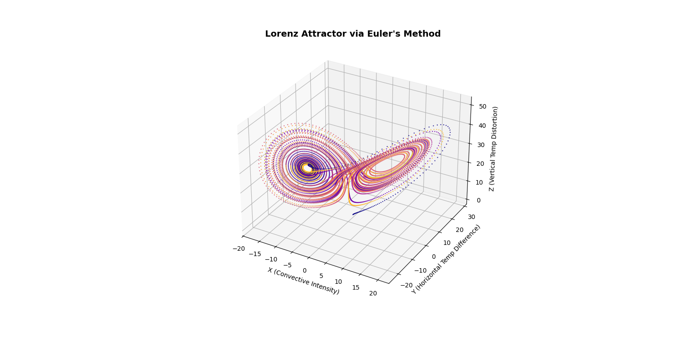
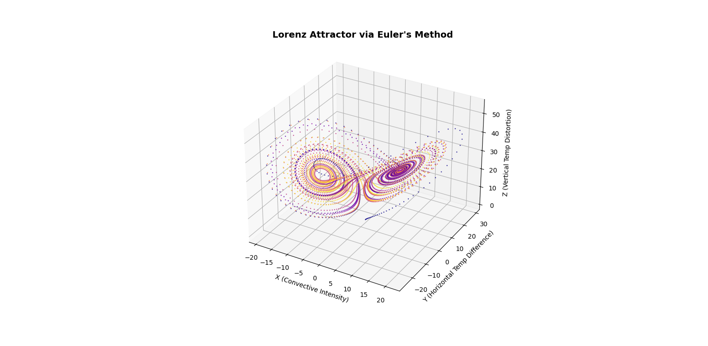
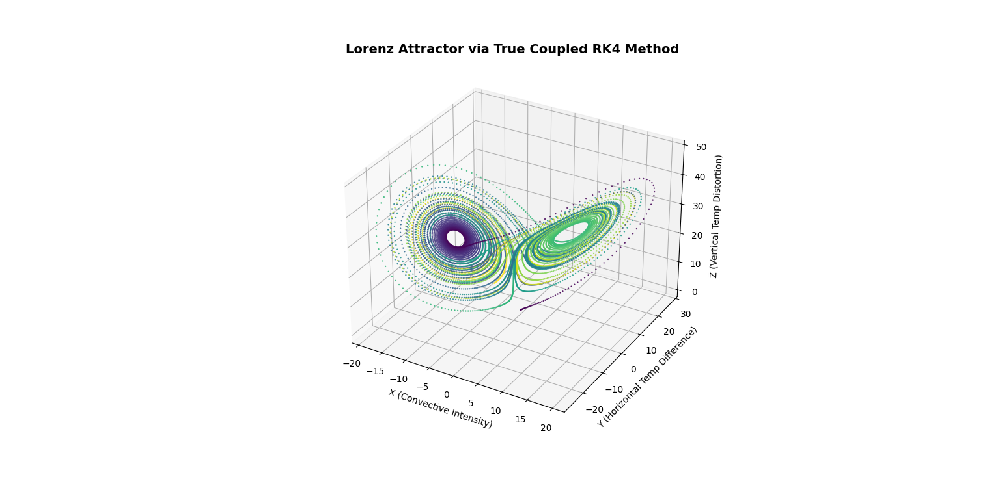
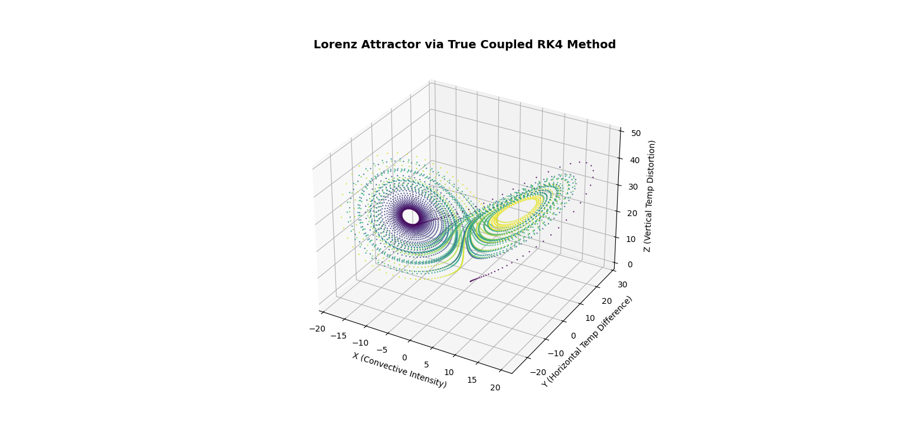
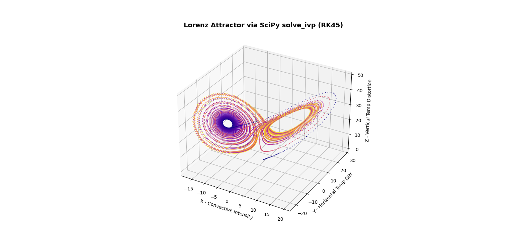
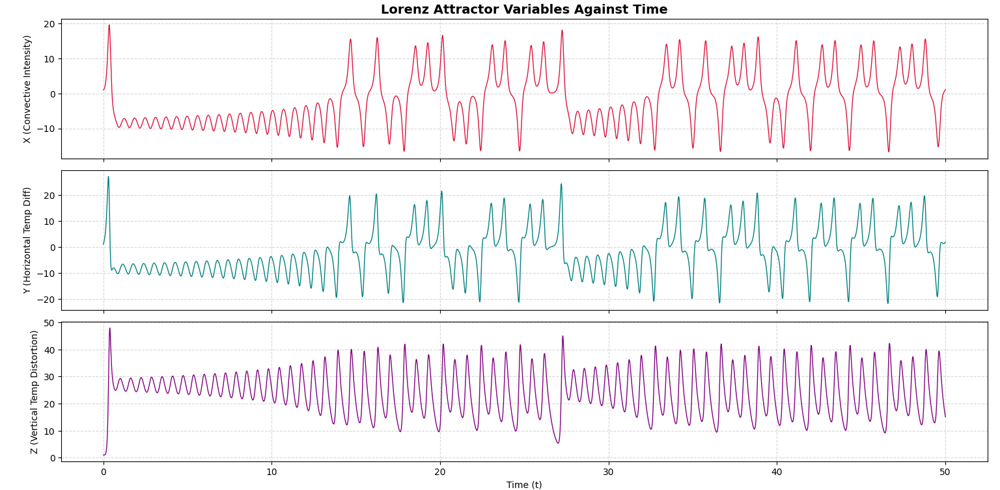
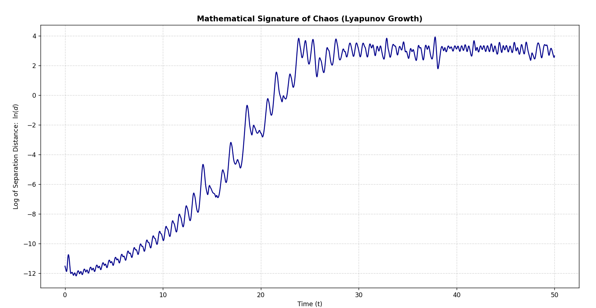

# The Lorenz Attractor

The Lorenz attractor equations are defined by this nonlinear system of first-order ordinary differential equations (ODEs):

$$
\begin{aligned}
\frac{dx}{dt} &= \sigma(y - x) \\
\frac{dy}{dt} &= x(\rho - z) - y \\
\frac{dz}{dt} &= xy - \beta z
\end{aligned}
$$

The system essentially models atmospheric convection. Because this system cannot be solved analytically, we will solve it numerically using the **Euler method** and the **RK4 (Runge-Kutta 4th Order) method**. 

---

### Variables & Physical Meaning
The states $x(t)$, $y(t)$, and $z(t)$ represent the physical properties of a fluid layer being heated from below:

* **$x(t)$** — The speed/rate at which the air rolls (convective intensity).
* **$y(t)$** — The horizontal temperature difference between ascending and descending fluids.
* **$z(t)$** — The vertical temperature profile distortion (how much it deviates from linear equilibrium).

### System Parameters (Constants)
* **$\sigma$ (Sigma)** — The Prandtl number, relating the fluid's kinematic viscosity to its thermal diffusivity.
* **$\rho$ (Rho)** — The Rayleigh number, representing the temperature difference driving the convection.
* **$\beta$ (Beta)** — A geometric factor representing the physical dimensions and aspect ratio of the fluid layer.

---

### Our system Parameters
We will be solving the classic Lorenz attractor problem with these conditions:
\
**$x(0) = 1$** \
**$y(0) = 1$** \
**$z(0) = 1$** \
**$\sigma = 10$** \
**$\rho = 28$** \
**$\beta = \frac{8}{3}$**

--- 

### Forward Euler Method

This is a 1-node quadrature method and is used to solve the problem: \
\
**$\frac{dy}{dt} = f(t, y)$** with **$y(t_0) = y_0$** and **$y(t_n) = ?$** \
\
The forward Euler method is defined as: 
\
**$y_{n+1} = y_n + hf(t_n, y_n)$**, where h is the step size.

The Forward Euler method however, becomes very unstable with a larger step size. If its amplification factor gets too large, it causes the numerical error to increase rather than decay. 

### Applying Forward Euler Method to our problem

Applying the approximation above to our system, we get these equations: \
\
**$x_{n+1} = x_n + h(\sigma(y_n - x_n))$** \
**$y_{n+1} = y_n + h(x_n(\rho - z_n) - y_n)$** \
**$z_{n+1} = z_n + h(x_ny_n - \beta*z_n)$**

---

### Rk4 Method for our problem

An extremely accurate method for approximating ODE's is the RK4 method, which is based on Simpson's quadrature rule and, for our problem:

$$
\mathbf{f}(\mathbf{u}) = \begin{bmatrix} \sigma(y - x) \\\ x(\rho - z) - y \\\ xy - \beta z \end{bmatrix}
$$

**$\vec{**k_1**} = \vec{**f**} (\vec{**u_n**})$** \
**$\vec{**k_2**} = \vec{**f**} (\vec{**u_n**} + \frac{h\vec{**k_1**}}{2})$** \
**$\vec{**k_3**} = \vec{**f**} (\vec{**u_n**} + \frac{h\vec{**k_2**}}{2})$** \
**$\vec{**k_4**} = \vec{**f**} (\vec{**u_n**} + h\vec{**k_3**})$** \
**$\vec{**u_{n+1}**} = \vec{**u_n**} + \frac{h(\vec{**k_1**} + 2\vec{**k_2**} + 2\vec{**k_3**} + \vec{**k_4**})}{6}$**

This method, unlike the Forward Euler method, can handle larger step sizes and still simulate the system with high accuracy

---

### Forward Euler results

This is the Forward Euler approximation with **$h = 0.005$**, approximating the solution from t=0 to t=50. We observe that we do get the classical butterfly pattern with our chosen step size; however, if we had to increase our step size, the approximation would fail. 

In the simulation above, we increased the step size to **$h = 0.01$**, and as expected, the model accuracy is far more unstable now and less accurate.  

--- 

### RK4 Results

This is the RK4 algorithm result with **$h = 0.005$**. We observe that the phase portrait is a bit more detailed using this algorithm, and here's what the approximation looks like if we had to increase our step size:

We increased the step size to **$h = 0.01$** in the simulation above, and we observe that it is far more accurate than the Forward Euler approximation with **$h = 0.01$**, it maintains its shape and trajectories far better even with a much larger step size. This demonstrates the accuracy of the RK4 method even at larger step sizes. 

---

### Scipy

This was done just to demonstrate how to work with dynamic systems in the real world using the very powerful mathematical computing module called Scipy. For this problem, we once again made use of the RK4 method

It's almost exactly the same as the RK4 method simulated previously, and this time we also observe how each individual variable evolves and changes with respect to time, the Time Series plot:

This plot explains how each variable evolves with time, as well as how they impact each other(from sudden drops and rises). 

--- 

### Chaos Analysis

Stability is one of the most important things to verify and check in numerical approximations and systems. For this we use Lyapunov Exponents to tell us how chaotic and unstable our system is. 

$$d(t) \approx d_0 e^{\lambda t}$$

Where:

* **$d(t)$**: The separation distance between the trajectories at time $t$.
* **$d_0$**: The initial separation distance at time $t = 0$.
* **$\lambda$**: The Lyapunov exponent.
* **$t$**: The elapsed time.

If:

* **$\lambda > 0$** - The system is chaotic and error grows exponentially
* **$\lambda <= 0$** - The system is stable

We visualise this using an Error Divergence Plot, where we use the baseline model and take its Euclidean Distance with a modified model and record that distance. We then plot the log of that distance, transforming the exponential growth:

We observe:

* From t=0 to t=25 the system has an increasing upward trend. This is the proof that we have that this system has exponential growth error, the slope of this region would be the maximum Lyapunov Exponent.
* From t=25 to t=50, we observe the separation distance oscillates between 2 and 4, this indicates the baseline simulation and modified simulation are now wandering independently of each other.
